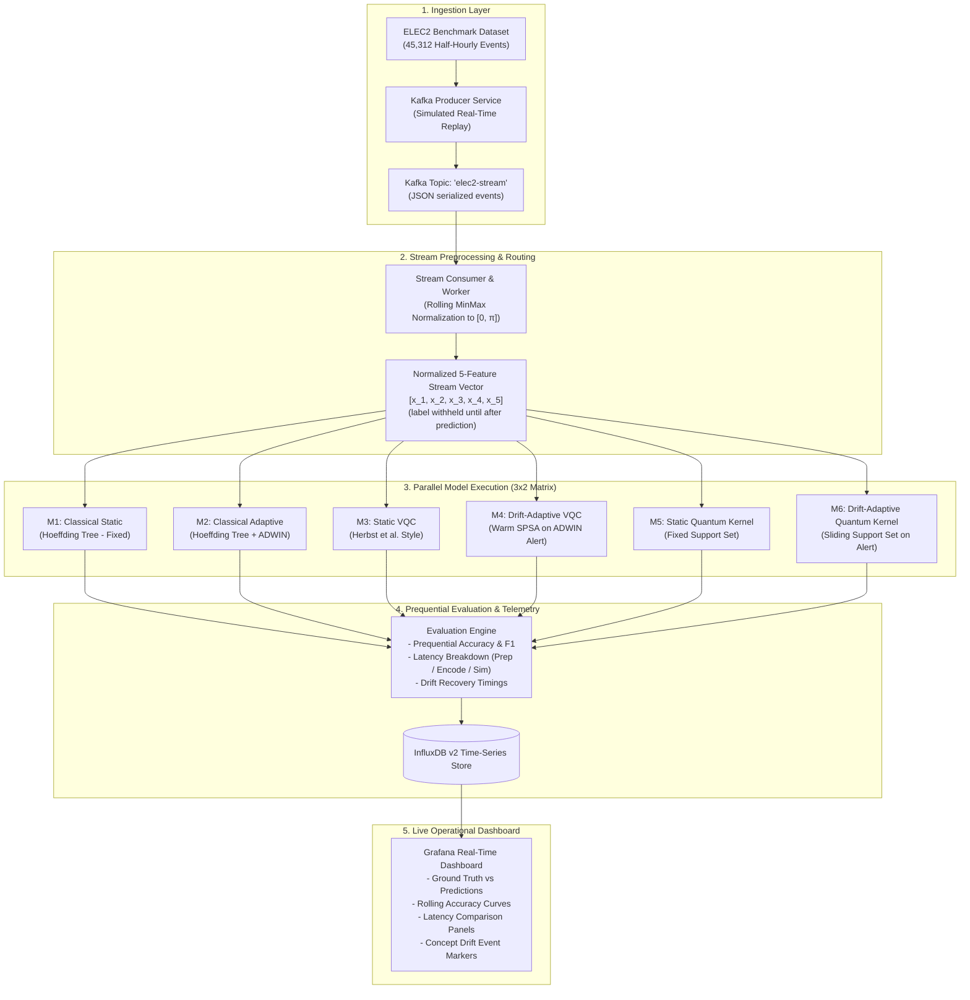
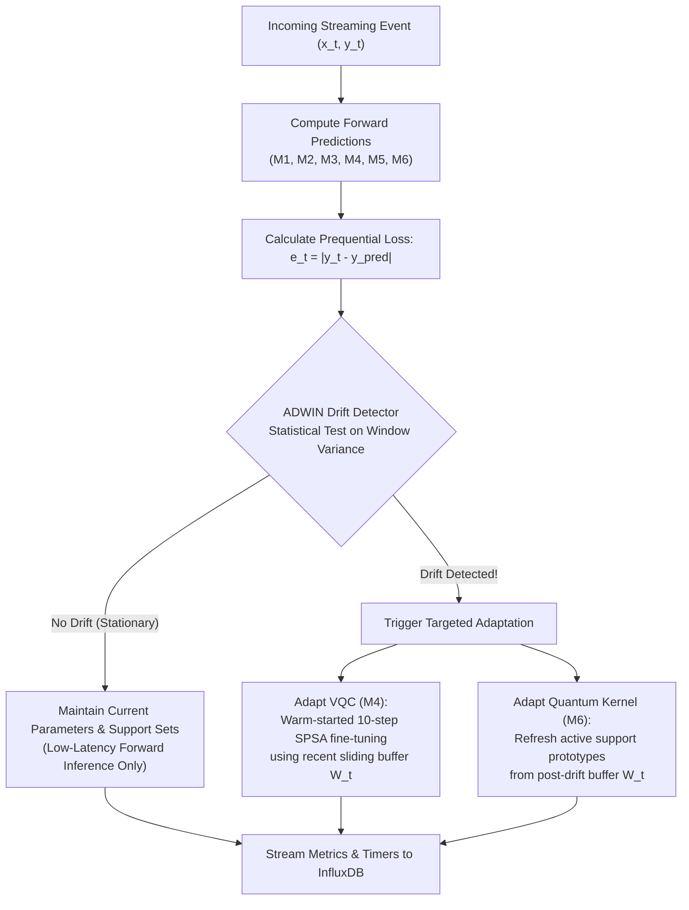

# **Implementation Plan: Quantum vs Classical Streaming Data Analytics**
### *An Experimental Study on Drift-Adaptive Quantum Machine Learning (Topic 4, Track C)*

---

## 1. Executive Summary & Core Objective

The goal of this project is to design, implement, and benchmark an end-to-end streaming data analytics pipeline that compares **Classical Streaming Machine Learning** with **Quantum Machine Learning (QML)** on non-stationary sensor/event streams.

The pipeline investigates a fundamental research question in streaming analytics:
> *"Does the theoretical expressiveness and sample-efficiency advantage of quantum machine learning survive under the real-time constraints, high velocity, and concept drift of a true streaming environment?"*

To evaluate this, we reproduce the foundational classical streaming baseline (**Domingos & Hulten, 2000**) as the primary reproduced method, adapt the quantum base models (**Herbst et al., 2024** and **Tscharke et al., 2023**) from their original offline regression/anomaly-detection settings to the ELEC2 streaming classification setting, and introduce a **Concept-Drift-Adaptive Quantum Streaming framework** applied symmetrically to both **Variational Quantum Classifiers (VQC)** and **Quantum Kernel Classifiers (QSVM)**. (See "Deviations from Proposal" at the end of this document for the precise reproduction-vs-adaptation scope.)

---

## 2. System Architecture & Track C Toolchain

The pipeline satisfies all requirements of **Track C (Generative & Quantum Methods)** with real data continuously flowing between independent services:



---

## 3. Dataset & Streaming Specification (Dimension 1)

### Dataset: Australian New South Wales Electricity Market (ELEC2)
- **Source:** Harries, M. (1999) / Built into `river.datasets.Elec2`.
- **Domain:** Half-hourly operational electricity market data from NSW and Victoria, Australia.
- **Records:** 45,312 chronological time steps spanning 2 years.
- **Task:** Binary classification: Predict whether the electricity price will rise (`UP = 1`) or stay flat/fall (`DOWN = 0`) relative to a 24-hour moving average.
- **Features Used (5 Continuous Predictors):**
  1. `nswprice`: NSW electricity spot price.
  2. `nswdemand`: NSW total electricity demand.
  3. `vicprice`: Victorian electricity spot price.
  4. `vicdemand`: Victorian total electricity demand.
  5. `transfer`: Scheduled electricity transfer between NSW and Victoria.
- **Why ELEC2 is Optimal:**
  - **Direct 5-Qubit Mapping:** 5 features correspond directly to 5 simulated qubits without needing lossy PCA compression.
  - **Clean Binary Quantum Measurement:** Target maps directly to single-qubit expectation value $\langle Z \rangle \in [-1, 1]$.
  - **Genuine Concept Drift:** Market deregulation, seasonal weather swings, and inter-state line constraints create distinct, well-documented concept drifts.
  - **Extensibility:** The ingestion interface is standardized (`timestamp`, `features`, `label`). Additional datasets (e.g., Seoul Bike or NSL-KDD) can be plugged into the same pipeline later with zero code refactoring in Kafka or Grafana.

---

## 4. Models & Experimental Design (Dimension 2)

We implement a complete **3 × 2 Comparative Matrix** evaluated on the identical stream:

| Paradigm | Model Variant | Architecture / Circuit Details | Update Mechanism | Role in Study |
| :--- | :--- | :--- | :--- | :--- |
| **Classical** | **M1: Static Tree** | `River` `HoeffdingTreeClassifier` | Trained on initial window $W_0$ (size=200), frozen thereafter. | Classical static control |
| **Classical** | **M2: Adaptive Tree** | `River` `HoeffdingAdaptiveTreeClassifier` (HATC) | Continuous incremental tree updates with ADWIN drift detection. | State-of-the-art classical streaming baseline (**Bifet et al., 2009** — adaptive Hoeffding tree; M1 reproduces **Domingos & Hulten, 2000**) |
| **Quantum Parametric** | **M3: Static VQC** | 5 Qubits, Angle / `ZFeatureMap`, `RealAmplitudes` Ansatz (depth=2), SPSA optimizer | Trained on $W_0$, frozen thereafter. | Static quantum baseline adapted from **Herbst et al.** |
| **Quantum Parametric** | **M4: Drift-Adaptive VQC** | 5 Qubits, identical circuit to M3 | Fast forward inference during stationary periods; triggers **warm-started, few-step SPSA fine-tuning** upon drift alert. | **Proposed Novelty (VQC)** |
| **Quantum Non-Parametric** | **M5: Static Quantum Kernel** | 5 Qubits, Fidelity Kernel $K(x, x') = \|\langle \phi(x) \| \phi(x') \rangle\|^2$, Scikit-Learn SVC | Support prototypes selected from $W_0$, frozen thereafter. | Quantum kernel baseline adapted from **Tscharke et al.** |
| **Quantum Non-Parametric** | **M6: Drift-Adaptive Quantum Kernel** | 5 Qubits, identical quantum kernel circuit to M5 | Evaluates against active support set; **refreshes support set from recent sliding window** upon drift alert. | **Proposed Novelty (Kernel)** |

---

## 5. The Novelty Specification (Dimension 3)

### The Research Gap
Existing literature on QML in IoT and edge settings (e.g., Herbst et al. 2024, Tscharke et al. 2023) evaluates models in **batch mode on static, shuffled data**. They do not account for:
1. Continuous data arrival under latency bounds.
2. The catastrophic accuracy degradation caused by non-stationary concept drift.
3. The computational impossibility of training quantum circuits from scratch on every incoming streaming event.

### The Proposed Mechanism: Dual Drift-Adaptive Quantum Learning
We introduce a lightweight, dual-mode adaptation framework:



### Metrics & Hypotheses to Compare
1. **Prequential Accuracy & F1-Score:** Does Drift-Adaptive VQC/Kernel maintain accuracy through seasonal market shifts, while Static VQC/Kernel collapses?
2. **Drift Recovery Rate ($N_{\text{recovery}}$):** How many events does each model require to return to baseline accuracy after an ADWIN drift signal?
3. **Fine-Grained Latency Decomposition:**
   $$\Delta t_{\text{event}} = t_{\text{network}} + t_{\text{prep}} + t_{\text{encode}} + t_{\text{sim}} + t_{\text{update}}$$
   - Compare classical execution latency (expected in the sub-millisecond range — to be verified experimentally, not assumed) against quantum state preparation and simulation.
4. **Sample Efficiency:** Does the quantum hypothesis hold—can the adaptive quantum kernel adapt with fewer support points than a classical RBF kernel?

---

## 6. Project Directory Layout & File Blueprint

```
IOE413-Quantum-Streaming/
├── docker-compose.yml              # Kafka, Zookeeper, InfluxDB v2, Grafana
├── requirements.txt                # Python dependencies (river, qiskit, pennylane, kafka-python, influxdb-client)
├── Proposal.md                     # Course submission proposal (updated with ELEC2 & Track C tools)
├── PLAN.md                         # This comprehensive design document
├── grafana/
│   ├── provisioning/
│   │   ├── datasources/datasource.yml
│   │   └── dashboards/dashboard_provider.yml
│   └── dashboards/
│       └── streaming_quantum_analytics.json
├── src/
│   ├── __init__.py
│   ├── config.py                   # Central configuration (topics, ports, circuit depth, qubits)
│   ├── producer/
│   │   ├── __init__.py
│   │   └── elec2_producer.py       # Replays ELEC2 into Kafka with configurable streaming delay
│   ├── worker/
│   │   ├── __init__.py
│   │   └── feature_worker.py       # Kafka consumer, MinMax scaler, sliding window buffer manager
│   ├── models/
│   │   ├── __init__.py
│   │   ├── classical_models.py     # River Hoeffding Tree (Static & Adaptive + ADWIN)
│   │   ├── vqc_models.py           # Qiskit VQC (Static vs. Warm-started Adaptive)
│   │   └── qsvm_models.py          # PennyLane Quantum Kernel (Static vs. Sliding Support)
│   ├── evaluation/
│   │   ├── __init__.py
│   │   ├── drift_manager.py        # ADWIN drift detection coordinator
│   │   └── prequential_eval.py     # Test-then-train metric calculator
│   ├── sink/
│   │   ├── __init__.py
│   │   └── influx_sink.py          # Formats and writes telemetry to InfluxDB
│   └── main.py                     # Main orchestrator running the streaming pipeline
└── experiments/
    ├── run_offline_benchmark.py    # Replays stream to generate publication figures for IEEE report
    └── plots/                      # Output directory for accuracy curves and latency bar charts
```

---

## 7. Component-by-Component Implementation Specification

### 7.1 Infrastructure (`docker-compose.yml`)
- **Apache Kafka + Zookeeper:** Exposes port `9092` for high-throughput message streaming.
- **InfluxDB v2:** Exposes port `8086`, stores streaming measurements under bucket `streaming_quantum`.
- **Grafana:** Exposes port `3000`, pre-configured with InfluxDB data source and pre-built dashboard.

### 7.2 Data Producer (`src/producer/elec2_producer.py`)
- Automatically loads the ELEC2 stream from `river.datasets.Elec2`.
- Formats each event:
  ```json
  {
    "event_id": 142,
    "timestamp": "1997-01-01T00:30:00Z",
    "features": {
      "nswprice": 0.0564,
      "nswdemand": 0.4321,
      "vicprice": 0.0034,
      "vicdemand": 0.4120,
      "transfer": 0.6123
    },
    "label": 1
  }
  ```
- Emits records to Kafka topic `elec2-stream` with a tunable pacing interval (e.g., 20–50 ms).

### 7.3 Stream Preprocessing Worker (`src/worker/feature_worker.py`)
- Reads raw events from Kafka.
- Applies online MinMax scaling mapping features to $[0, \pi]$ (the optimal range for quantum rotational gates $R_x(\theta), R_z(\theta)$).
- Maintains a fixed FIFO sliding buffer ($W = 100$ records) to supply training data for drift adaptation.

### 7.4 Model Suite (`src/models/`)
1. **Classical (`classical_models.py`):**
   - Model 1: `tree.HoeffdingTreeClassifier` (fitted on initial 200 records, updates disabled).
   - Model 2: `tree.HoeffdingAdaptiveTreeClassifier` with integrated ADWIN drift detector.
2. **Variational Quantum Classifier (`vqc_models.py`):**
   - Implemented using `Qiskit` / `Qiskit Machine Learning`.
   - Feature Map: 5-qubit Angle / `ZFeatureMap`.
   - Ansatz: `RealAmplitudes` with linear entanglement (depth = 2, total 15 trainable parameters).
   - Cost function: Cross-entropy / parity expectation loss.
   - Adaptation: Warm-started SPSA optimizer (10 iterations on sliding buffer).
3. **Quantum Kernel Classifier (`qsvm_models.py`):**
   - Implemented using `PennyLane`.
   - Circuit: 5-qubit AngleEmbedding + CNOT entangling layers.
   - Evaluates kernel matrix $K_{ij} = |\langle 0 | U^\dagger(x_j) U(x_i) | 0 \rangle|^2$.
   - Adaptation: Replaces the oldest 20% of support vectors with recent post-drift prototypes.

### 7.5 Telemetry & Sink (`src/sink/influx_sink.py`)
- Emits three InfluxDB measurements per streaming event:
  - `prequential_accuracy`: Rolling accuracy, precision, recall, and F1 for all 6 models.
  - `latency_telemetry`: Prep time, quantum encoding time, circuit simulation time, and classical execution time.
  - `drift_events`: Timestamps, magnitude, and which models triggered adaptation.

### 7.6 Grafana Real-Time Dashboard
- **Panel 1:** Real-time stream throughput gauge (events/sec) and cumulative event counter.
- **Panel 2:** Multi-line graph: Rolling Prequential Accuracy (M1 through M6) with vertical markers indicating ADWIN drift alerts.
- **Panel 3:** Grouped bar chart: Latency breakdown (Classical sub-ms vs. Quantum State Prep vs. Circuit Simulation).
- **Panel 4:** Confusion matrix / prediction agreement between Classical Adaptive Tree and Drift-Adaptive VQC.

---

## 8. Verification & Validation Strategy

When execution begins, the pipeline will be validated across three stages:

### Stage 1: Component Unit Tests
- Verify Kafka producer publishes and consumer deserializes correctly.
- Verify feature normalizer bounds features strictly within $[0, \pi]$.
- Verify Qiskit VQC and PennyLane Quantum Kernel produce valid binary predictions $\{0, 1\}$.
- Verify River classical models predict and update without memory leaks.

### Stage 2: Streaming Integration Smoke Test
- Launch Docker Compose (Kafka, InfluxDB, Grafana).
- Stream 200 events through the entire pipeline.
- Confirm metrics arrive in InfluxDB and Grafana panels update in real-time.

### Stage 3: Full Non-Stationary Benchmark & Report Generation
- Run the full 45,312-event stream (or accelerated replay).
- Export empirical accuracy curves, drift recovery stats, and latency distributions.
- Generate figures and LaTeX tables formatted for the 6–8 page IEEE conference paper.

---

## 9. Deliverables Mapping to Course Rubric (50 Marks)

| Deliverable | Course Requirement | Where It Is Handled |
| :--- | :--- | :--- |
| **Proposal & Lit Review (5 pts)** | 2–3 papers summarized (a–e), problem statement, tool justification. | Updated `Proposal.md` incorporating ELEC2, Kafka, and the dual adaptation study. |
| **Tool Integration (15 pts)** | Genuine streaming data flow, no isolated scripts, Kafka + Dashboard. | Real-time Kafka → Stream Worker → InfluxDB → Grafana pipeline. |
| **Enhancement / Novelty (8 pts)** | Non-trivial, implemented enhancement over base papers. | Drift-Adaptive Quantum Learning (ADWIN-triggered VQC fine-tuning and Kernel support refresh). |
| **Results & Evaluation (7 pts)** | Meaningful metrics, fair comparison, honest reporting of quantum bottlenecks. | 3×2 Comparative Matrix, prequential accuracy, latency breakdown, drift recovery rate. |
| **Report Quality (7 pts)** | 6–8 pages, IEEE 2-column format, architecture diagrams. | Final report generated using IEEE conference template with auto-generated experimental plots. |
| **Demo & Defense (8 pts)** | $\le$10 min live walkthrough, defense of tool choices and design trade-offs. | Live Grafana dashboard demonstrating real-time streaming, drift alerts, and quantum adaptation. |

## 10. Engineering Standards & Implementation Practices

### 10.1 Code Quality and Maintainability

- Write clean, readable, modular Python code. Optimize for correctness and maintainability before premature optimization.
- Follow PEP 8 and use descriptive names for modules, classes, functions, variables, and configuration values.
- Use type hints for public functions, class methods, and important data structures.
- Keep functions focused on a single responsibility. Avoid unnecessarily large functions, duplicated logic, deeply nested conditionals, and monolithic modules.
- Separate configuration, data ingestion, preprocessing, model inference, model updates, evaluation, and telemetry responsibilities.
- Define clear interfaces between components so that individual models and infrastructure services can be tested independently.
- Prefer simple, established solutions over unnecessary abstractions or additional dependencies.
- Use structured logging rather than scattered print statements. Include sufficient context to diagnose errors in the streaming pipeline.
- Handle exceptions explicitly. Do not silently suppress errors or return fabricated predictions, metrics, or success statuses.
- Remove dead code, unused imports, temporary debugging statements, and obsolete implementations before considering a component complete.

### 10.2 Documentation

- Maintain a root `README.md` explaining the research objective, architecture, prerequisites, installation, configuration, startup, execution, testing, and shutdown procedures.
- Keep `PLAN.md` as the system design and implementation specification. Update it when an approved design decision materially changes.
- Add concise docstrings to public classes and functions, explaining their purpose, inputs, outputs, and important side effects.
- Document non-obvious algorithms, quantum circuit design choices, drift-adaptation logic, evaluation methodology, and non-trivial implementation decisions.
- Maintain a `.env.example` containing placeholders for required environment variables. Never commit credentials, tokens, or other secrets.
- Document Docker services, exposed ports, required environment variables, persistent volumes, and health checks.
- Document how to reproduce experiments, configure random seeds, export results, and regenerate plots.
- Keep documentation synchronized with the actual implementation. Do not document planned features as completed functionality.

### 10.3 Configuration and Dependency Management

- Centralize configurable parameters such as Kafka topics, broker addresses, service ports, replay speed, window sizes, circuit depth, optimizer settings, drift thresholds, and logging levels.
- Keep environment-specific configuration separate from application logic.
- Pin or constrain dependency versions in the project's dependency-management files and record the Python version used for experiments.
- Use a consistent, documented dependency-management workflow. Do not introduce new dependencies without a clear justification.
- Ensure the application starts with a documented configuration and reports missing or invalid settings clearly.
- Provide sensible defaults for local development without embedding machine-specific paths or credentials.

### 10.4 Testing and Validation

- Write automated unit tests for preprocessing, scaling, model prediction, model updates, drift handling, metric calculations, and event serialization.
- Add tests for edge cases, including empty windows, missing or invalid features, unexpected labels, duplicate events, and service failures where applicable.
- Test that predictions are generated before the corresponding labels are used for learning or metric updates.
- Add integration tests for Kafka ingestion, processing, telemetry persistence, and the end-to-end pipeline.
- Test static and adaptive model behavior independently before running the complete six-model experiment.
- Include regression tests for bugs discovered during implementation.
- Use mocks or lightweight test configurations where external services or quantum simulation would make tests unnecessarily slow.
- Keep a clear distinction between unit tests, integration tests, smoke tests, and full experimental benchmarks.

### 10.5 Experimental Reproducibility and Scientific Integrity

- Ensure that all models receive the same events in the same chronological order.
- Use prequential evaluation: predict first, evaluate against the arriving label, and only then perform permitted model updates.
- Prevent target leakage, future-data leakage, and unintended use of post-drift samples in pre-drift predictions.
- Record random seeds, dependency versions, model configurations, dataset details, and relevant experiment parameters.
- Use consistent evaluation windows and clearly document how rolling metrics and drift-recovery times are calculated.
- Record prediction latency, adaptation latency, and end-to-end processing latency separately.
- Do not fabricate experimental results or present unexecuted benchmarks as completed.
- Clearly distinguish simulated quantum execution from execution on actual quantum hardware.
- Report failed experiments, resource limitations, and deviations from the planned methodology.

### 10.6 Infrastructure and Operational Reliability

- Make Docker Compose startup and shutdown procedures reproducible and document the required commands.
- Configure health checks and appropriate service dependencies for infrastructure components where supported.
- Handle Kafka disconnections, consumer errors, unavailable telemetry services, and malformed messages without silently corrupting evaluation results.
- Avoid unbounded in-memory queues, buffers, caches, and metric histories.
- Ensure that long-running streaming processes can shut down gracefully and flush pending telemetry when feasible.
- Use bounded retries with appropriate backoff for transient failures. Avoid infinite retry loops that conceal permanent failures.
- Keep service credentials and sensitive configuration out of source control.
- Document data persistence, restart behavior, and how to reset experiment state between runs.

### 10.7 Change Management and Completion Criteria

- Inspect the existing repository and its configuration before modifying files. Preserve working functionality unless a change is necessary.
- Implement incrementally in small, verifiable steps rather than generating the entire system in one pass.
- Do not silently change the approved architecture, experimental methodology, model definitions, or deliverables. Document material deviations and obtain approval when they affect the research objectives.
- After each implementation stage, run the relevant tests and checks before proceeding.
- Before declaring a task complete, run the applicable tests, formatting and linting checks, and type checks where configured.
- Review the changes for correctness, readability, unnecessary complexity, and consistency with the documentation.
- Update tests and documentation alongside the implementation.
- Maintain a clear record of completed work, remaining tasks, known issues, and commands used to validate the changes.
- Never claim that a test, benchmark, service startup, or integration check passed unless it was actually executed and its result verified.

---

## 11. Deviations from Proposal & Scope Notes

This section documents material differences between `Proposal.md` and this implementation
plan, per Sec. 10.7 (change management).

1. **Dataset scope:** The proposal listed three candidate sources (Seoul Bike, ELEC2, an
   anomaly-detection set). The implementation uses **ELEC2 only**, chosen for its genuine
   concept drift, direct 5-feature → 5-qubit mapping, and binary label (see Sec. 3).
2. **Task type:** The proposal discussed regression (MSE/MAE) and anomaly detection (AUC),
   inherited from the base papers. The implementation is **binary classification**
   (prequential accuracy/F1), matching ELEC2's standard task.
3. **Reproduction vs. adaptation:** Only the **Domingos & Hulten (2000)** Hoeffding-tree
   baseline (M1) is a direct reproduction. **Herbst et al. (2024)** (variational *regressor*
   on Seoul Bike) and **Tscharke et al. (2023)** (QSVR anomaly detection) are **adapted** to
   streaming binary classification on ELEC2 (M3/M5); their reported MSE/AUC results are not
   directly comparable to ours and are not claimed to be reproduced.
4. **Enhancement mechanism:** The proposal described periodic fixed-window retraining. The
   implemented enhancement is **event-triggered adaptation** (ADWIN alert → warm-started SPSA
   fine-tuning / support-set refresh), which is strictly more streaming-native and is the
   mechanism evaluated in the report.
5. **Model matrix:** Extended from 3×2 to **4×2** with classical RBF-kernel controls
   (M7 static / M8 adaptive, identical support-set budget and refresh rule as M5/M6) so the
   sample-efficiency hypothesis (Sec. 5, Hypothesis 4) has a capacity-matched classical
   counterpart.
6. **Attribution correction:** The adaptive Hoeffding tree (M2) is due to **Bifet et al.
   (2009)**, not Domingos & Hulten (2000); M1 is the Domingos & Hulten reproduction.
7. **Evaluation policy:** Headline accuracy metrics are computed **post-warmup** (from event
   $W_0+1$), because models M3–M6 cannot produce informed predictions before their initial
   training window $W_0$ fills; full-stream metrics are reported as secondary.
